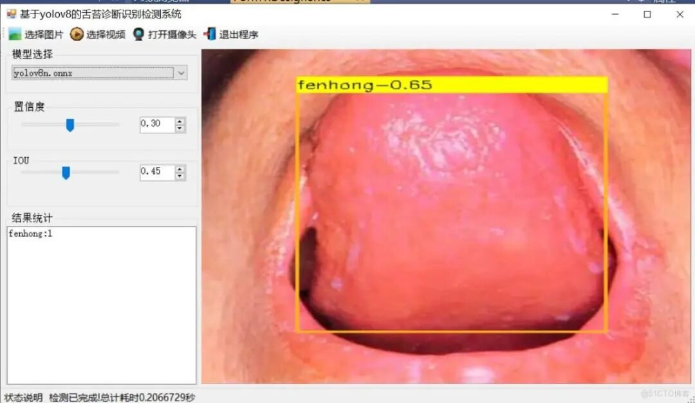
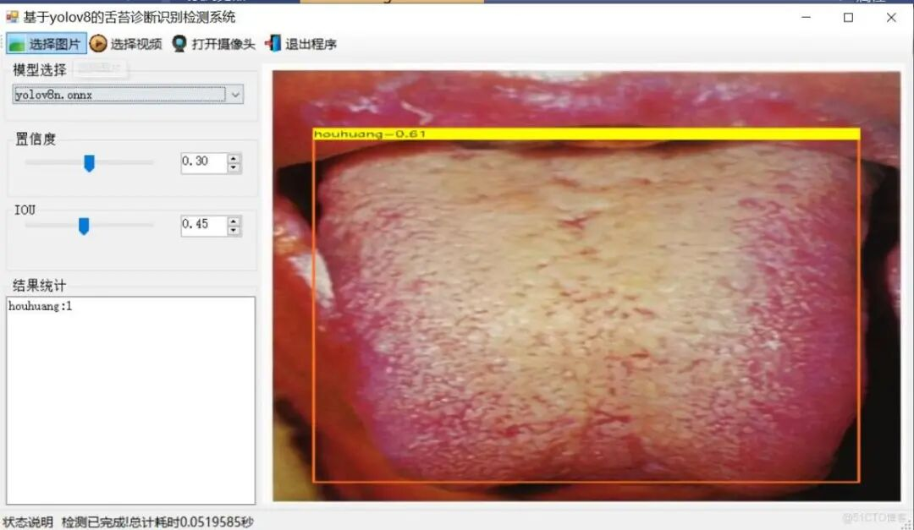

# [C#][winform] Sialicosis Diagnosis and Detection System Based on YOLOv8 C# Source Code + ONNX Model + Evaluation Indicator Curve + Elegant GUI Interface

[Algorithm Introduction]The tongue coating identification detection system based on YOLOv8 is an innovative application that integrates advanced computer vision technology.

[Algorithm Introduction]

A tongue coating detection system based on YOLOv8 is an innovative application that integrates advanced computer vision technology. As the latest version of the YOLO series object detection model, YOLOv8 is renowned for its excellent detection speed and precision, enabling real-time and accurate identification and localization of multiple objects in images. In the field of tongue coating detection, the application of YOLOv8 has significantly improved the efficiency and accuracy of detection.

The system trains the YOLOv8 model. Make it capable of recognizing key features in tongue coatings. Typical coloration, Tongue color Traces of teeth marks and cracks, etc. These characteristics are crucial for the identification of Traditional Chinese Medicine (TCM) constitutions. Users only need to upload tongue coating pictures. The system can quickly analyze and display the recognition results. At the same time, in conjunction with Traditional Chinese Medicine theory. Provide corresponding physical information judgment.

Compared with traditional detection methods, The tongue coating recognition detection system based on YOLOv8 has the advantages of high speed. High precision Significant advantages such as multi-platform compatibility and multitask support. It can not only simplify the detection process, Reduce detection costs. It can also improve the objectivity and accuracy of the detection results. Provides strong support for the identification of traditional Chinese medicine constitutions. Furthermore, The system can also be widely used in the field of medicine. In fields such as health management, etc. To provide the public with more convenient... High-efficiency health services.

[Effect Display]





[Test Environment]

Windows 10 x64 system, VS2019, netFramework4.7.2, OpenCVSharp4.9.0, ONNXRuntime1.22.0

The model can detect the category.

houbai (thick white) huihei (gray black) houhuang (thick yellow) fenhong (pink red) bobai (thin white)

[Training Information]

|

Parameters

 ||

Value

 |
|

Number of training set images

 ||

720

 |
|

Number of images in the validation set

 ||

80

 |
|

Training map

 ||

98.9%

 |
|

Training Accuracy

 ||

96.0%

 |
|

Training recall rate

 ||

96.8%

 |

##### Validation set test accuracy information

|

Class

 ||

Images

 ||

Instances

 ||

P

 ||

R

 ||

mAP50

 ||

mAP50-95

 |
|

all

 ||

80

 ||

80

 ||

0.96

 ||

0.968

 ||

0.989

 ||

0.847

 |
|

houbai

 ||

19

 ||

19

 ||

0.994

 ||

0.947

 ||

0.993

 ||

0.865

 |
|

huihei

 ||

10

 ||

10

 ||

0.995

 ||

1

 ||

0.995

 ||

0.782

 |
|

houhuang

 ||

15

 ||

15

 ||

0.933

 ||

1

 ||

0.987

 ||

0.881

 |
|

fenhong

 ||

20

 ||

20

 ||

0.95

 ||

0.954

 ||

0.983

 ||

0.855

 |
|

bobai

 ||

16

 ||

16

 ||

0.929

 ||

0.938

 ||

0.988

 ||

0.854

 |

[Interface Design]

-
-
-
-
-
-
-
-
-
-
-
-
-
-
-
-
-
-
-
-
-
-
-
-
-
-
-
-
-
-
-
-
-
-
-
-
-
-
-
-
-
-
-
-
-
-
-
-
-
-
-
-
-
-
-
-
-
-
-
-
-
-
-
-
-
-
-
-
-
-
-
-
-
-
-
-
-
-
-
-
-
-
-
-
-
-
-
-
-
-
-
-
-
-
-
-
-
-
-
-
-
-
-
-
-
-
-
-
-
-
-
-
-
-
-
-
-
-
-
-
-
-
-
-
-
-
-
-
-
-
-
-
-
-
-
-
-
-
-
-
-
-
-
-
-
-
-
-
-
-
-
-
-
-
-
-
-
-
-
-
-
-
-
-
-
-
-
-
-
-
-
-
-
-
-
-
-
-
-
-
-
-
-
-
-
-
-
-
-
-
-
-
-
-
-
-
-
-
-
-
-
-
-
-
-
-
-
-
-
-
-
-
-
-
-
-
-
-
-
-
-
-
-
-
-
-
-
-
-
-
-
-
-
-
-
-
-
-
-
-
-
-
-
-
-
-
-
-
-
-
-
-
-
-
-
-
-
-
-
-
-
-

```
using DeploySharp.Data;using OpenCvSharp;using System;using System.Collections.Generic;using System.ComponentModel;using System.Data;using System.Diagnostics;using System.Drawing;using System.IO;using System.Linq;using System.Text;using System.Threading;using System.Threading.Tasks;using System.Windows.Forms;
namespace FIRC{    public partial class Form1 : Form    {
        public bool videoStart = false;// Video stop flag
        }        public string GetResultString(DetResult[] result)        {            Dictionary<string, int> resultDict = new Dictionary<string, int>();            for (int i = 0; i < result.Length; i++)            {                if(resultDict.ContainsKey( result[i].Category) )                {                    resultDict[result[i].Category]++;                }                else                {                    resultDict[result[i].Category] =1;                }            }
            var resultStr = "";            foreach(var item in resultDict)            {                resultStr += string.Format("{0}:{1}\r\n",item.Key,item.Value);            }            return resultStr;        }        private void tsb_pic_Click(object sender, EventArgs e)        {            OpenFileDialog ofd = new OpenFileDialog();            ofd.Filter = "*.*|*.bmp;*.jpg;*.jpeg;*.tiff;*.tiff;*.png";            if (ofd.ShowDialog() != DialogResult.OK) return;            tssl_show.Text = "Detecting......";            Task.Run(() => {                var sw = new Stopwatch();                sw.Start();                Mat image = Cv2.ImRead(ofd.FileName);                detetor.SetParams(Convert.ToSingle(numericUpDown1.Value), Convert.ToSingle(numericUpDown2.Value));                var results=detetor.Inference(image);
                var resultImage = detetor.DrawImage(image, results);
sw.Stop(); pb_show.Image = OpenCvSharp.Extensions.BitmapConverter.ToBitmap(resultImage); tb_res.Text = GetResultString(results); tssl_show.Text = "Detection completed!" Total elapsed time is "+sw.Elapsed.TotalSeconds+" seconds"; });
        }
        public void VideoProcess(string videoPath)        {            Task.Run(() => {
                detetor.SetParams(Convert.ToSingle(numericUpDown1.Value), Convert.ToSingle(numericUpDown2.Value));                VideoCapture capture = new VideoCapture(videoPath);                if (!capture.IsOpened())                {                    tssl_show.Text="Video failed to open!";                    return;                }                Mat frame = new Mat();                var sw = new Stopwatch();                int fps = 0;                while (videoStart)                {
                    capture.Read(frame);                    if (frame.Empty())                    {                        Console.WriteLine("data is empty!");                        break;                    }                    sw.Start();                    var results = detetor.Inference(frame);                    var resultImg = detetor.DrawImage(frame,results);                    sw.Stop();                    fps = Convert.ToInt32(1 / sw.Elapsed.TotalSeconds);                    sw.Reset();                    Cv2.PutText(resultImg, "FPS=" + fps, new OpenCvSharp.Point(30, 30), HersheyFonts.HersheyComplex, 1.0, new Scalar(255, 0, 0), 3);                    // Display results
                }
                capture.Release();
pb_show.Image = null; tssl_show.Text = "Video has stopped!" "; tsb_video.Text = "Select Video";
            });        }        public void CameraProcess(int cameraIndex=0)        {            Task.Run(() => {
                detetor.SetParams(Convert.ToSingle(numericUpDown1.Value), Convert.ToSingle(numericUpDown2.Value));                VideoCapture capture = new VideoCapture(cameraIndex);                if (!capture.IsOpened())                {                    tssl_show.Text = "Camera failed to open!";                    return;                }                Mat frame = new Mat();                var sw = new Stopwatch();                int fps = 0;                while (videoStart)                {
                    capture.Read(frame);                    if (frame.Empty())                    {                        Console.WriteLine("data is empty!");                        break;                    }                    sw.Start();                    var results = detetor.Inference(frame);                    var resultImg = detetor.DrawImage(frame, results);                    sw.Stop();                    fps = Convert.ToInt32(1 / sw.Elapsed.TotalSeconds);                    sw.Reset();                    Cv2.PutText(resultImg, "FPS=" + fps, new OpenCvSharp.Point(30, 30), HersheyFonts.HersheyComplex, 1.0, new Scalar(255, 0, 0), 3);                    // Display results
                }
                capture.Release();
pb_show.Image = null; tssl_show.Text = "Camera has been stopped!" "; tsb_camera.Text = "Open Camera";
            });        }        private void tsb_video_Click(object sender, EventArgs e)        {            if(tsb_video.Text=="Select video")            {                OpenFileDialog ofd = new OpenFileDialog();                ofd.Filter = "Video files(*.*)|*.mp4;*.avi";                if (ofd.ShowDialog() != DialogResult.OK) return;                videoStart = true;                VideoProcess(ofd.FileName);                tsb_video.Text = "Stop";                tssl_show.Text = "Video is being detected....";
            }            else            {                videoStart = false;
            }        }
        private void tsb_camera_Click(object sender, EventArgs e)        {            if (tsb_camera.Text == "Turn on the camera")            {                videoStart = true;                CameraProcess(0);                tsb_camera.Text = "Stop";                tssl_show.Text = "Camera is in detection mode....";
            }            else            {                videoStart = false;
            }        }
        private void tsb_exit_Click(object sender, EventArgs e)        {            videoStart = false;            this.Close();        }
        private void trackBar1_Scroll(object sender, EventArgs e)        {            numericUpDown1.Value = Convert.ToDecimal(trackBar1.Value / 100.0f);        }
        private void trackBar2_Scroll(object sender, EventArgs e)        {            numericUpDown2.Value = Convert.ToDecimal(trackBar2.Value / 100.0f);        }
        private void numericUpDown1_ValueChanged(object sender, EventArgs e)        {            trackBar1.Value = (int)(Convert.ToSingle(numericUpDown1.Value) * 100);        }
        private void numericUpDown2_ValueChanged(object sender, EventArgs e)        {            trackBar2.Value = (int)(Convert.ToSingle(numericUpDown2.Value) * 100);        }
        private void comboBox1_SelectedIndexChanged(object sender, EventArgs e)        {            tssl_show.Text="Load model:"+comboBox1.Text;            detetor.LoadWeights(weightsPath+"\\"+comboBox1.Text);            tssl_show.Text = "Model loading is complete.!";        }    }}
```

```

```

[Common Evaluation Parameters Introduction]

In the task of object detection, evaluating the performance of a model is crucial. The terms you mentioned are commonly used metrics for assessing the performance of a model. Here are detailed explanations of these terms:

Class: This usually refers to the category of targets that the model is designed to detect. For example, A model may be trained to detect vehicles... Objects of different categories such as pedestrians or animals. Images: Represents the number of images in the verification set. Validation set is a dataset used to evaluate the model performance. Separate from the training set. To ensure the fairness of the assessment results. Instances: The total number of target objects in all images. This includes the total of all categories of objects. For example, If the validation set contains 100 images. Each image has an average of 5 target objects. Then, the Instances are 500. P (Precision): Precision is the proportion of positive instances predicted by the model. The proportion of truly positive samples.The formula is: Precision = TP / (TP + FP), where TP represents True Positives and FP represents False Positives. R (Recall): Recall is the proportion of all true positive samples correctly predicted by the model. The formula is: Recall = TP / (TP + FN), where FN represents False Negatives. mAP50: It represents the average precision at IoU threshold of 0.5.IoU is an indicator for measuring the degree of overlap between predicted bounding boxes and ground truth bounding boxes. mAP is a comprehensive metric that considers both precision and recall, used to evaluate the performance of models at different recall levels. At IoU=0.5, if the overlap between the predicted bounding box and the ground truth bounding box reaches or exceeds 50%, it is considered correct. mAP50-95: It represents the average accuracy of the model within the range of IoU from 0.5 to 0.95 (with a step of 0.05). This is a more stringent evaluation standard, requiring higher overlap between predicted and ground truth bounding boxes. In object detection tasks, higher IoU thresholds mean that the model needs to be more accurate in target object localization.The calculation of mAP50-95 takes into account multiple IoU thresholds from loose to strict, thus providing a more comprehensive evaluation of the model's performance. These metrics collectively form an important framework for assessing the performance of target detection models. By comparing the performance of different models on these metrics, it is possible to determine which model may be more effective in practical applications.

[Usage Steps]

Usage Steps: 1. First, install the Yolov8 environment according to the official framework Ultralytics installation tutorial, and convert your own PT model into an ONNX model using the official export command. Then, go to the GitHub repository futureflsl/firc-csharp-projects to find the source code. 2. Open the Sln project in Visual Studio 2019, select x64 release, and modify some necessary parameters, such as input shape, etc., then click run to view the final result.

Please note that if there are any runtime errors, refer to my blog for re-invoking the DLL of my source code: [C#] OpenCVSharp error System.Memory, Version=4.0.1.2, Culture=neutral, PublicKeyToken=cc7b13fcd2ddd51 "Version higher than the referenced_ failed to load file or assembly" "system.memory, version=4.0.1.2, culture-CSDN blog

[Provided Files]

C[# Source Code] YOLOv8n.onnx Model (No PyTorch model provided)

Training map, P, R curve graph (in weights\results.png)

Test images (under test_img folder)

Please note that the provided training dataset is here.


## Payment

Here is a pay link on Stripe ( https://buy.stripe.com/3cs8yP7sY87d0vu9AB ). Please contact me lonlonago@foxmail.com after funding $89, and I will send you a complete data files , thank you!


